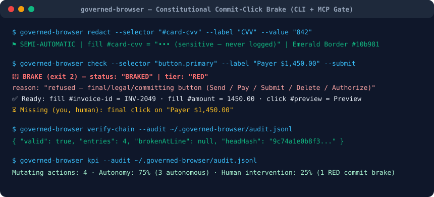

# `governed-browser`

[](https://github.com/JavierFrancoLeal/governed-browser/actions/workflows/ci.yml)
[](LICENSE)

**The browser-agent safety gate that physically refuses to click `Send`, `Pay`, `Submit`, `Delete`, or `Authorize` — enforced in code, not in a prompt.**



`governed-browser` is the 4th flagship in the open-source Agent Governance suite (alongside [`casebook`](https://github.com/JavierFrancoLeal/casebook), [`dual-brain-guard`](https://github.com/JavierFrancoLeal/dual-brain-guard), [`autonomy-ladder`](https://github.com/JavierFrancoLeal/autonomy-ladder), and [`forensic-contracts`](https://github.com/JavierFrancoLeal/forensic-contracts)). It decouples the constitutional browser safety rails from `jfranco-cockpit-browser` into a **zero-dependency Node.js CLI, stdio MCP Server, and portable plugin** for Playwright, Chrome DevTools Protocol (CDP), Claude Code, Gemini CLI, Cursor, Google Antigravity, and DeepSeek Harness (DSH).

---

## Why `governed-browser`?

When an AI agent drives a browser, telling it *"please ask before submitting or paying"* in a system prompt eventually fails. `governed-browser` enforces four mechanical invariants in code:

1. **Code-Level Commit-Click Brake (`🛑 RED`):** Blocks committing clicks (`Send`, `Pay`, `Submit`, `Delete`, `Authorize`, `Sign in`, `Checkout`, `Envoyer`, `Payer`, `Supprimer`, `Enviar`, `Pagar`, `Eliminar`, plus `input[type="submit"]`) with Unicode `NFD` diacritic stripping and word-boundary precision (so `"Pays"` / *Country* or `"Code postal"` never false-positive).
2. **Constitutional Downgrade Rule:** A forbidden committing button can **only** be downgraded from `RED` by an **exact normalized full-label match** in the human's `tiers.md` policy file (e.g., `Create draft -> GREEN`). A generic substring rule (`account -> GREEN`) can never unlock `"Delete account"`.
3. **Proactive Secret Redaction & SHA-256 Hash-Chained Ledger (`audit.jsonl`):** Passwords, API keys, tokens, CVV, and 2FA codes are scrubbed to `••• (sensitive — never logged)` before hitting disk, and every entry is chained via SHA-256 (`prevHash -> hash`).
4. **Two-Section Accountability Report & Autonomy Efficiency KPI:** Separates automatic actions to verify (`GREEN` / `⚑ SEMI-AUTOMATIC`) from `🛑 RED` brakes handed back to the human, and measures `Autonomy (%)` vs. `Human Intervention (%)`.

---

## 30-Second Quickstart

```bash
git clone https://github.com/JavierFrancoLeal/governed-browser.git
cd governed-browser
npm test

# 1. Check a safe non-committing button (Exit 0 — ALLOWED)
node src/cli.mjs check --selector "#preview-btn" --label "Preview invoice" --record-audit

# 2. Check a committing payment button (Exit 2 — BRAKED / RED)
node src/cli.mjs check --selector "#pay-btn" --label "Payer $1,450.00" --submit --record-audit

# 3. Verify the cryptographic SHA-256 audit chain & view the Accountability Report
node src/cli.mjs verify-chain
node src/cli.mjs report
node src/cli.mjs kpi
```

---

## MCP Server Integration (Claude Code / Cursor / Gemini CLI / Antigravity)

Add `governed-browser-mcp` to your `mcpServers` config so any browser-driving agent must pass pre-click and form-fill checks:

```json
{
  "mcpServers": {
    "governed-browser": {
      "command": "node",
      "args": ["/absolute/path/to/governed-browser/src/mcp-server.mjs"]
    }
  }
}
```

Exposed MCP tools:
- `cockpit_check_click` — returns `{ allowed, status: "ALLOWED" | "PROPOSE_WAIT" | "BRAKED", tier, reason }`
- `cockpit_record_fill` — proactively redacts secrets and appends a SHA-256 chained `fill` record
- `cockpit_get_report` — renders the two-section Accountability Report + Autonomy KPI
- `cockpit_verify_audit_chain` — verifies `audit.jsonl` for tampering

---

## Technical Essay

Read the full engineering postmortem and design rationale in [**Why Browser Agents Need a Hard Commit Brake in Code, Not a Prompt**](docs/ESSAY_THE_AGENT_NEVER_CLICKS_SEND.md).

---

## Open-Source Agent Governance Suite

| Repository | Role | Status |
| :--- | :--- | :--- |
| **[`casebook`](https://github.com/JavierFrancoLeal/casebook)** | Bounded-entropy 4-tier constitutional memory, Open Symptoms Radar & 5-to-1 compaction oracle | **`v1.0.1` Live** |
| **[`dual-brain-guard`](https://github.com/JavierFrancoLeal/dual-brain-guard)** | Harness-agnostic mechanical Proposer != Verifier cross-model guard (`CLI + MCP + hooks`) | **`v1.1.1` Live** |
| **[`autonomy-ladder`](https://github.com/JavierFrancoLeal/autonomy-ladder)** | Evidence-based Traffic-Light autonomy grader (`🟢 / ⚑ / 🟡 / 🔴` & `A/B/C/D` trust scores) | **`v1.0.2` Live** |
| **[`governed-browser`](https://github.com/JavierFrancoLeal/governed-browser)** | Constitutional commit-click brake (`🛑 RED` on Send/Pay/Delete) & SHA-256 hash-chained audit trail | **`v1.0.1` Live** |
| **[`forensic-contracts`](https://github.com/JavierFrancoLeal/forensic-contracts)** | 5-line `@forensic-contract` linter, `@blast-radius` cage enforcer & literal `sourcePin` verifier | **`v1.0.1` Live** |
| **[`agent-governance`](https://github.com/JavierFrancoLeal/agent-governance)** | Complete 26-plugin DeepSeek Harness governance suite (mother repository) | **`v1.0.0` Live** |
| **[`best-security-governance-architects`](https://github.com/JavierFrancoLeal/best-security-governance-architects)** | CPU-first pre-merge security & governance suite (`ECOSYSTEM_CONTRACT v1.2.0`) | **`v1.2.0` Live** |
| **[`best-ui-ux-designers`](https://github.com/JavierFrancoLeal/best-ui-ux-designers)** | Adversarial UI/UX design judgment suite — 12 Barbell design minds & 4 Via Negativa auditors | **`v1.2.0` Live** |

---

## License

Apache-2.0 — see [LICENSE](LICENSE).
